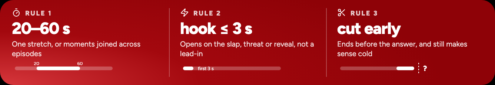
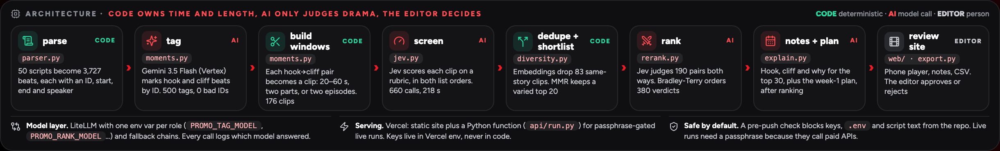
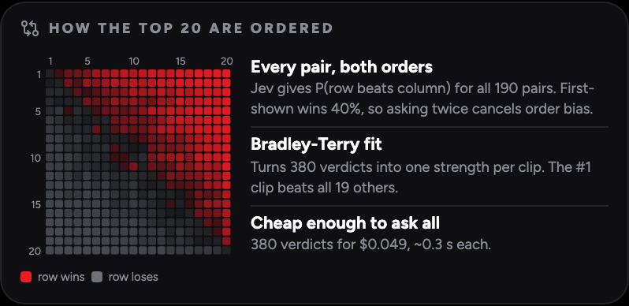
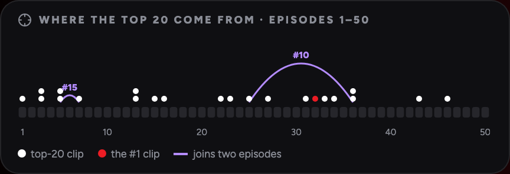
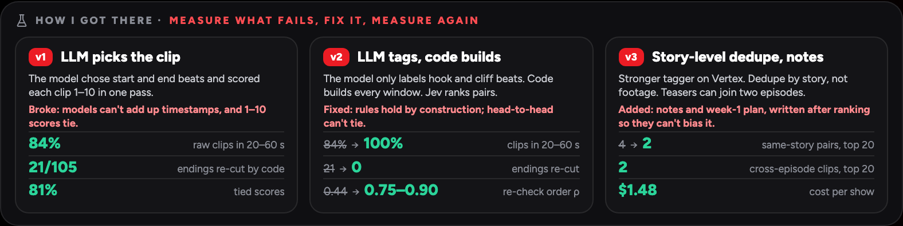
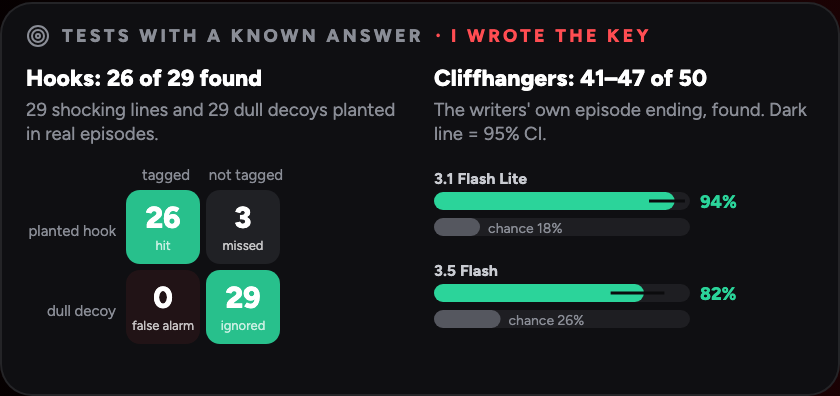
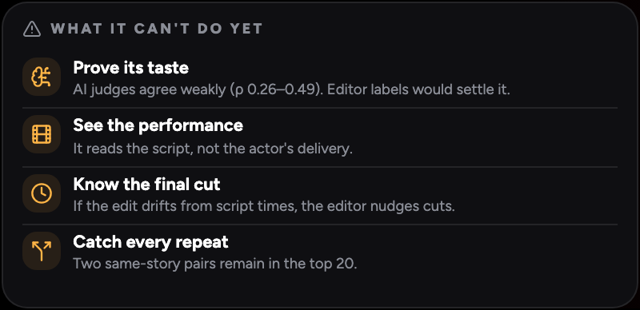
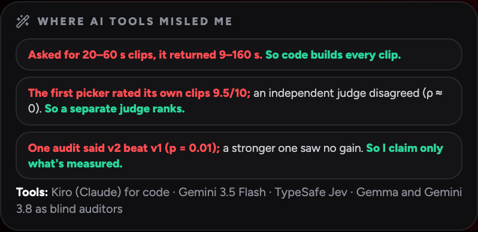

<p align="center"></p>

<p align="center">
<a href="https://promo-finder-five.vercel.app"><b>Live site</b></a> ·
<a href="#run-it">Run it</a> ·
<a href="#how-it-works">How it works</a> ·
<a href="#how-i-got-there">How I got there</a> ·
<a href="#does-it-work">Does it work</a> ·
<a href="#what-it-cant-do-yet">Limits</a>
</p>

Built by **Aman Kumar**.

## The problem

Microdrama apps release a new show every week, and each one needs a stream of short promos for social feeds. Today an editor watches the whole show, about 103 minutes for 50 episodes, to find the moments worth cutting. Promo Finder reads the timestamped screenplay instead. It returns a ranked list of 20–60 s promos, each with:

- the episode and exact start and end time of every segment, in order;
- the hook (the first 3 s), the cliffhanger it cuts on, and one line on why it works;
- a week-1 posting plan that holds back clips which give away twists.

On a real 50-episode show it produced 93 ranked promos in about 7 minutes, for about $1.48 at API list prices. The editor's job drops to watching the top 20 (15 min) or approving the 5 week-1 posts (3 min).

## Live site

**https://promo-finder-five.vercel.app**

| Tab | What it shows |
|---|---|
| 🎞 50-episode show | The full run on a real 50-episode show, open to everyone. Phone player for each promo with its script lines in sync, hook / cliff / why notes, head-to-head record, week-1 plan, CSV and deck download. |
| ▶ Try it live | Runs the real pipeline on Vercel, on a 4-episode sample show or up to 5 episodes you upload. It calls paid LLM APIs, so it needs a passphrase (ask me); keys stay on the server. About 30–90 s. |
| 🎬 Public demo | The same views on an AI-written 4-episode sample show, open to everyone. |
| 💻 Run locally | The commands below. |

The site shows the 50-episode results openly. The scripts themselves are not stored in this repo.

## The three rules every clip must pass



Rules 1 and 2 are enforced by code, so they can't break: **0 of 176 candidates** violate them. Rule 3 is a judgement, so the AI tags and ranks it.

## How it works



The main idea: **the model never writes a timestamp or picks a length.** Models are bad at adding up times, so they only do what they are good at, which is labelling drama. Code does the arithmetic.

| Step | File | Who | What happens | On the 50-episode show |
|---|---|---|---|---|
| Parse | `promo/parser.py` | code | Screenplay → beats with an ID, start, end, speaker and type | 3,727 beats |
| Tag | `promo/moments.py` | AI | One call per episode marks HOOK and CLIFF beats by ID, with a 1–10 strength | 500 tags, 0 invalid IDs |
| Build windows | `promo/moments.py` | code | Every hook → cliff pair becomes a clip: one stretch if 20–60 s apart, a two-part teaser + run-up if 60–240 s apart, or a teaser from one episode joined to a cliff in a later one | 176 candidates, 0 rule breaks |
| Screen | `promo/jev.py` | AI | TypeSafe Jev scores every clip on a rubric, asked in both list orders | 660 calls, 218 s |
| Dedupe + shortlist | `promo/diversity.py` | code | Embeddings find clips that tell the same story, even from different episodes. MMR picks a varied top 20 | 83 duplicates dropped |
| Rank | `promo/rerank.py` | AI + code | Jev judges every shortlist pair in both orders. A Bradley-Terry fit turns the verdicts into one strength per clip | 190 pairs, 380 verdicts, $0.049 |
| Notes + plan | `promo/explain.py` | AI | Writes hook, cliff and why for the top 30, and the week-1 plan. Runs after ranking, so it can't bias the order | 5 posts, 7 held back |
| Review | `web/`, `app.py` | editor | Phone player with the script around each cut. Approve or reject; decisions are saved as labels | |

**Model layer.** Every role has its own model and fallback chain, set by one env var (`PROMO_TAG_MODEL`, `PROMO_SCREEN_MODEL`, `PROMO_RANK_MODEL`, `PROMO_JEV_MODEL`), through LiteLLM, so any provider works. Every call records which model answered. Without a TypeSafe key, an LLM Swiss tournament does the ranking instead of Jev.

**Why pairwise ranking.** Asking "rate this clip 1–10" gave 81% tied scores in v1, and the order changed on every re-run. Asking "which of these two would you post?" can't tie. Jev favours the clip shown first only 40% of the time, so every pair is asked both ways and the bias cancels.



### Where the top 20 come from



## How I got there

I built a simple version first, measured where it failed, fixed one thing at a time and measured again. Full write-up: [`experiments/ANALYSIS.md`](experiments/ANALYSIS.md).



| What I measured | v1 | Final (v3) |
|---|---|---|
| Raw clips inside 20–60 s | 84% | **100%** |
| Endings cut short by code repairs | 21 of 105 | **0** |
| Tied scores in the ranking | 81% | **0%** |
| Same top-20 order on a re-check (split-half Spearman) | 0.44 | **0.75–0.90** |
| Same-story pairs in the top 20 | 4 | **2** |
| Cost per 50-episode show | not measured | **$1.48** |

- **v1: the LLM picks the clip.** It chose start and end beats itself and scored each clip 1–10 in one pass. It returned clips from 9 to 160 s, and code repairs then cut endings badly.
- **v2: the LLM tags, code builds.** The model only labels hook and cliff beats. Code builds every window, so the rules hold by construction. Jev replaced the 1–10 scores with pairwise judging.
- **v3: better tagger, story dedupe, notes.** Tagging moved to Gemini 3.5 Flash on Vertex. Dedupe now works on story, not just overlapping footage. Teasers can join two episodes. Notes and the week-1 plan were added after ranking.

## Does it work

I tested the parts I could check against an answer key that no AI wrote ([`experiments/REALWORLD_RESULTS.md`](experiments/REALWORLD_RESULTS.md)).



- **Planted hooks.** I inserted 29 shocking lines and 29 dull decoys into real episodes. The tagger marked 26 of the 29 shocking lines as hooks (a random tagger finds about 4) and 0 of the 29 decoys.
- **Writers' cliffhangers.** Each episode ends on a cliffhanger the writers chose. The tagger found it in 41–47 of 50 episodes depending on the model, against 18–26% by chance.
- **Rules.** 0 of 176 clips break the length or hook rule. 81% of pairwise verdicts are the same in both orders.

## What it can't do yet

 

- **Prove its taste.** Three AI judges agree with each other only weakly (Spearman 0.26–0.49), and two blind audits disagreed on whether v2 beat v1. What's proven is the process: rules, no re-cuts, no ties, a reproducible order, speed and cost. Whether people prefer these promos needs editor labels or view data, which the review UI collects.
- **See the performance.** It reads the script, so a slap is judged from the description, not the actor's delivery.
- **Know the final cut.** Times come from the script. If the edit drifts, the editor nudges the in and out points.
- **Catch every repeat.** Two same-story pairs are still in the top 20.

## AI tools I used, and where they misled me

- **Kiro (Claude)** for research, code and analysis. **Gemini 3.5 Flash** (Vertex) for tagging and notes. **TypeSafe Jev** as the judge. **Gemma 4 31B** and **Gemini 3.8 Flash** as blind auditors.
- Asked for 20–60 s clips, the model returned 9–160 s. Patching that in code damaged the endings. The fix was to stop asking the model for arithmetic.
- The first picker rated its own clips 9.5/10, and an independent judge didn't agree (Spearman ≈ 0). So a separate judge ranks.
- One audit said v2 beat v1 (p = 0.01); a stronger auditor saw no difference. So I only claim what is measured.
- The assistant read a daily quota error as a per-minute one and kept retrying. The client now detects daily caps and falls back to the next model.

## Run it

```bash
python3 -m venv .venv && .venv/bin/pip install -r requirements-local.txt
cp .env.example .env                                   # add keys, see below

.venv/bin/python run.py "<show folder>" --out runs/latest      # full pipeline
.venv/bin/python run.py "<show folder>" --episodes 1,2,3        # quick test on 3 episodes
.venv/bin/python demo.py runs/new_show_test                     # no keys: view a saved run
.venv/bin/streamlit run app.py                                  # editor review UI (approve / reject)
.venv/bin/python tests/test_parser.py                           # parser tests, no keys
.venv/bin/python scripts/dev_server.py                          # the site + live-run API on localhost:3000
```

**Keys.** A free `GEMINI_API_KEY` from AI Studio runs everything, with fallbacks. `VERTEX_API_KEY` moves tagging and notes to Vertex Gemini 3.5 Flash. `TYPESAFE_API_KEY` turns on Jev for screening and ranking. Any LiteLLM model string can be set per role, for example `PROMO_RANK_MODEL=openai/gpt-5-mini`.

**Input.** One file per episode (`.txt`, `.md` or `.fountain`). The parser accepts several layouts: `**LABEL:**` or `LABEL:` blocks, `NAME (Emotion):` dialogue, and times like `Start: (mm:ss.ff) | End: (...)`, `[mm:ss.ff - mm:ss.ff]`, `mm:ss,ff --> mm:ss,ff` or `1.0s - 4.8s`. If it finds nothing usable it stops with a clear error. [`tests/fixtures/new_show/`](tests/fixtures/new_show/) is an AI-written 4-episode show in a different format that proves a new show runs end to end ([output](runs/new_show_test/report.md)).

**Outputs** (in `--out`): `promos.json`, `promos.csv`, `report.md` (posting plan and every promo with its segments, hook, cliff and why), `meta.json` (models used, costs, rule checks) and `diagnostics.json` (every tag, window and verdict).

## Repo layout

| Path | What |
|---|---|
| `run.py`, `promo/pipeline_v2.py` | Final pipeline (v3) |
| `promo/` | `parser`, `moments` (tags + windows), `jev`, `rerank` (pairwise + Bradley-Terry), `diversity` (dedupe + MMR), `explain` (notes + plan), `llm` (model routing, fallbacks, cache), `export` |
| `run_v1.py`, `promo/pipeline.py`, `promo/report.py` | v1 baseline, kept for the before/after comparison |
| `experiment.py`, `experiments/` | Baseline, v1 vs v2, Jev, blind audits, real-life tests, with the scripts that produced them |
| `tests/` | Parser tests and the synthetic 4-episode show |
| `runs/new_show_test/` | Pipeline output on the synthetic show |
| `web/`, `api/run.py`, `vercel.json` | The site and the live-run function on Vercel |
| `app.py` | Streamlit review UI |
| `deck/build_deck.py`, `scripts/build_docs.py` | Build the 2-page solution PDF and these README images from the run files |
| `scripts/check_secrets.py` | Pre-push guard: blocks keys, `.env`, the passphrase and any script text from the pack |

Not in git: `.env`, the licensed scripts, the runs on them, and the deck PDF (it quotes script lines). Deploy notes: [`DEPLOY.md`](DEPLOY.md).

## Ideas I reused

Selecting from candidates instead of generating timestamps (constrained temporal selection, arXiv 2606.20890); pairwise ranking asked in both orders (Pairwise Ranking Prompting, Qin et al. 2023); repeated trials against judge noise ("The Coin Flip Judge", arXiv 2606.13685); Jev as a judge (arXiv 2609.26550); score + hook + reason output from open-source shorts generators (AI-Youtube-Shorts-Generator, deepclip); MMR for diversity; LiteLLM for model routing.
